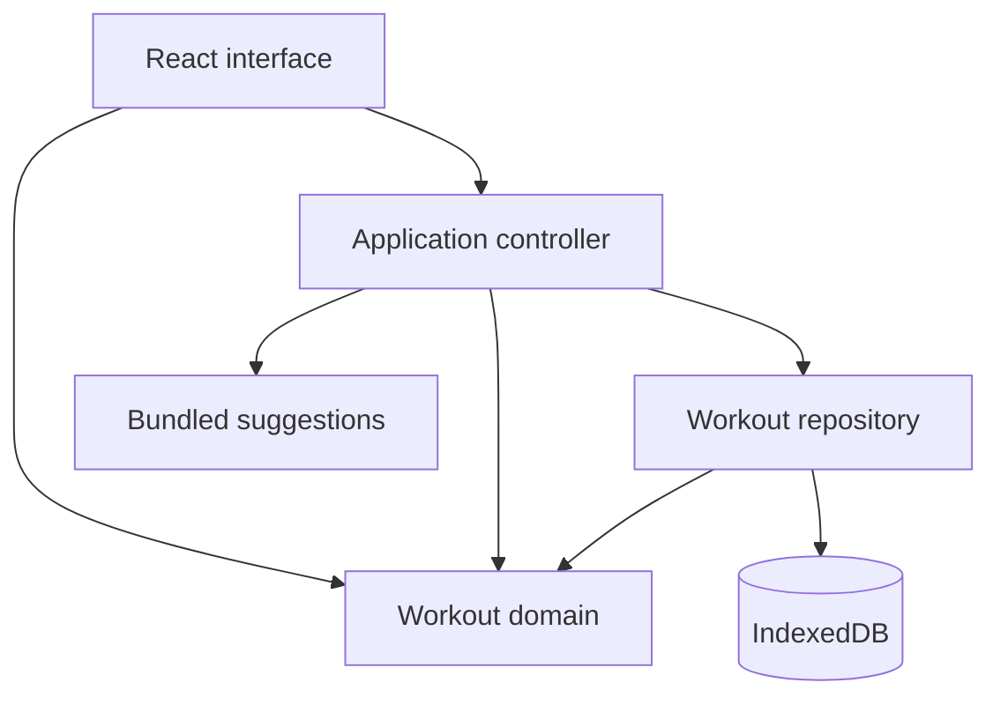

# Architecture Spine — RunReady

## Design paradigm

A layered, browser-only application. React renders the interface; an application controller owns draft and operation state; pure domain functions validate workouts and calculate duration; one repository owns IndexedDB access. No application backend is required.



## Invariants and rules

### AD-1 — Layer ownership [ADOPTED]

- **Binds:** All application modules.
- **Prevents:** Components writing storage directly, duplicated workout models, and domain logic depending on rendering or storage APIs.
- **Rule:** Follow the dependency arrows above. Domain code has no React, browser-storage, or network dependency. UI actions go through the application controller for draft changes and repository operations. The repository is the only IndexedDB caller. Shared types and validation live in the domain; repository metadata and error contracts live alongside its interface. No global state library or service framework is required.

### AD-2 — One workout contract and calculation path [ADOPTED]

- **Binds:** FR-1–FR-4, FR-6; editor, preview, suggestions, and storage.
- **Prevents:** Different interval interpretations, incompatible saved formats, and totals drifting from the plan.
- **Rule:** A workout has a name and ordered items. An item is either a standalone phase (`type`, `durationSeconds`) or an interval block (`runSeconds`, `recoverySeconds`, `repetitions`). Standalone types are `warm-up`, `run`, `recovery`, and `cool-down`. Durations and repetitions are positive safe integers. Interval blocks cannot nest; every repetition includes recovery, including the last. One pure validator and one pure duration calculator serve every consumer. Total seconds are derived, never persisted as authoritative data. Reject values or totals beyond safe integer arithmetic rather than saving a rounded result. Blank workouts may exist as drafts but cannot be saved.

### AD-3 — Draft isolation and explicit commands [ADOPTED]

- **Binds:** FR-1, FR-2, FR-5, FR-7, FR-9.
- **Prevents:** Editing suggestions or saved objects in place, autosaving, and confusing updates with copies.
- **Rule:** The controller owns one in-memory draft, its saved baseline, and an optional source workout ID/revision. Opening a suggestion or library entry creates an independent draft. Editable numeric fields retain raw text until validation succeeds; incomplete input is not coerced to zero. Preview renders that draft and uses the domain calculation only when valid. Dirty state compares editable content to its baseline. New/copy commands create a new ID; update targets the source ID. After a successful create, copy, or update, set the baseline and active source ID/revision to the committed record; subsequent updates target that record. Failure leaves the baseline and source unchanged. In-app actions replacing a dirty draft require stay/discard confirmation. Browser reload/crash draft recovery is outside scope.

### AD-4 — Repository integrity and failure contract [ADOPTED]

- **Binds:** FR-5–FR-8, NFR-4.
- **Prevents:** Unintended overwrites, false success, duplicate pending saves, and treating storage failures as empty libraries.
- **Rule:** Store complete workouts by stable UUID, never by name; duplicate names are valid. The repository provides asynchronous list, get, create, update, and delete operations. Successful create/update operations return the complete committed record, including its ID and revision; copying uses create with a new ID. Each write uses one read/write transaction. Create uses insert-only semantics; update never silently creates a missing record. Each saved record carries `schemaVersion: 1`, `id`, `createdAt`, `updatedAt` (UTC ISO strings), `revision` (positive integer), and canonical workout content. Updates and deletes compare an expected revision inside the same transaction; stale or missing records return a conflict/missing result without changing data. Updates preserve ID/creation time and increment revision. A copy receives a new ID and revision 1.

  Resolve write success only on transaction completion, not request success. Abort, blocked/unavailable storage, invalid records, missing records, and revision conflicts return distinct recoverable error results. Retain the draft and last confirmed library state on failure; show its stale/error status rather than claiming it is current. Bind every write to an immutable snapshot; while it is pending, disable draft editing, replacement/navigation actions, and additional mutations. Restore controls after success or failure, applying the committed result through AD-3. Retrying a create retains its operation ID; if that ID already contains the same committed record, treat the retry as success rather than inserting another record. Deletion requires the PRD confirmation before invoking the repository. Never reset or overwrite a database automatically after a read, schema, or validation error. Close connections on version changes and explain blocked upgrades with retry guidance.

### AD-5 — Self-contained runtime and storage origin [ADOPTED]

- **Binds:** FR-1, FR-5, NFR-3; build and hosting.
- **Prevents:** Online-only assets breaking a loaded session and deployment changes making the library appear lost.
- **Rule:** Bundle suggestions and every asset required by core journeys; load core application code at startup. Runtime editing, preview, and repository operations make no network requests. Deploy the static build over HTTPS at a stable origin. Explain same-browser/device retention, browser-data clearing, and lack of synchronization or backup. Origin changes expose a different library; keep preview/test origins separate from the evaluation origin. No service worker or offline-start guarantee is required. Application updates must not silently erase stored records; future schema changes require an explicit, preserving migration.

### AD-6 — Verification at the boundaries [ADOPTED]

- **Binds:** All FRs and NFRs; implementation and prototype evaluation.
- **Prevents:** A passing calculation masking broken storage, connectivity, or accessible user journeys.
- **Rule:** Verify the domain's validation and duration examples; repository create/update/copy/delete, transaction failure, stale-revision, and retry behavior; and both PRD journeys through the real browser repository. Include a failed save/load preserving the draft, no false success, connectivity loss after loading, 320-pixel width, 200% text, keyboard-only use, and a mobile screen reader. Use semantic controls, labeled inputs, visible focus, text errors/status announcements, and non-drag reorder actions. Exercise current iOS Safari, Android Chrome, and desktop Chrome as defined in PRD.md and record tested versions. Prototype value-validation observations follow PRD §7; they are separate from automated checks.

## Stack seed

Exact initial baselines, verified November 3, 2026. Once scaffolded, package.json and the committed lockfile own resolved versions.

| Name | Version |
| --- | --- |
| Node.js (local build runtime) | 24.13.0 |
| npm | 11.6.2 |
| React / React DOM | 19.3.1 |
| TypeScript | 7.0.2 |
| Vite | 8.3.5 |
| @vitejs/plugin-react | 6.1.2 |

Start from the official `react-ts` template; retain its development checks. The [live template manifest](https://raw.githubusercontent.com/vitejs/vite/main/packages/create-vite/template-react-ts/package.json) supplies the framework baselines. The [Vite guide](https://vite.dev/guide/) defines runtime requirements and static build support. IndexedDB is a browser API, with transaction behavior checked against the [MDN guide](https://developer.mozilla.org/en-US/docs/Web/API/IndexedDB_API/Using_IndexedDB).

## Structural seed

```text
src/
  ui/             editor, preview, library, confirmations, status
  application/    draft/controller state and explicit commands
  domain/         shared workout types, validation, duration
  storage/        repository contract and IndexedDB implementation
  suggestions/    fixed example workouts
```

Development uses the local development server; evaluation uses a static production build at a stable HTTPS origin. Host/provider selection is deferred until deployment. Serve core assets from that origin. No secrets, remote database, account service, application server, telemetry service, or cloud infrastructure are required. Operational checks cover asset loading and browser-storage errors; record test failures without uploading workout content. Rollbacks replace static assets and must retain compatibility with already-written records.

## Capability map

| PRD area | Owner | Rules |
| --- | --- | --- |
| Starting and editing, FR-1–FR-3 | UI, controller, domain, suggestions | AD-1–AD-3 |
| Preview and duration, FR-4 | UI and domain | AD-2–AD-3 |
| Saving and reuse, FR-5–FR-8 | Controller and repository | AD-3–AD-5 |
| Unsaved changes, FR-9 | Controller and UI | AD-3 |
| Accessibility, mobile, integrity, connectivity, NFR-1–NFR-5 | UI, repository, build and verification | AD-4–AD-6 |

## Deferred

- Component names, precise function signatures, state-hook choice, styling, test libraries, and additional dependencies: choose during implementation while keeping the shared contracts above.
- Static host, deployment automation, and release URL: select before first external evaluation; keep its origin stable afterward.
- Additional schema versions and migrations: design when a format change is needed; existing data must remain intact.
- Automatic multi-tab refresh: deferred; revision checks still protect against stale writes and deletes.
- Offline startup, draft crash recovery, accounts/synchronization, speech, workout execution, tracking, sharing, imports, and exports: outside the approved prototype; revisit only after a scope decision.

No unresolved blocking assumptions remain. This spine records the agreed architecture; implementation and participant evaluation remain future work.
